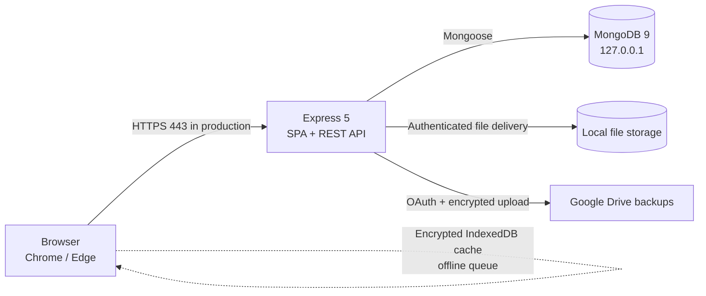

# Architecture

> This document describes the approved architecture. Only Phase 0 infrastructure is implemented at this time.

## System context



Only Express will listen on the LAN. MongoDB stays on loopback. In production, Express serves the built SPA and API from the same origin.

## Principles

1. Server-authoritative financial calculations.
2. Integer financial units: micro-USD, ticks, and hundredths.
3. Separate Trading, Learning, and Personal Journal domains.
4. Personal Journal data is never imported by analytics, dashboard, poster, trading, or learning services.
5. Missing fees, risk, or R values are explicit “unavailable,” never invented.
6. Offline changes are not presented as synced until server confirmation.
7. Soft delete plus 30-day trash; append-only audit history.
8. LAN-only, HTTPS-only deployment; no public exposure.
9. One Node process, one MongoDB database, no Docker or extra infrastructure.
10. Manual updates only.

## Runtime

- Node.js 26 LTS.
- Express 5 API.
- React 19 SPA built by Vite 8.
- MongoDB 9 through Mongoose 9.
- Development: Vite on `127.0.0.1:5173`, API on `127.0.0.1:4000`, `/api` proxy.
- Production: Express serves `dist/client` and `/api/v1` over HTTPS on port 443.
- No CORS in production because the app is same-origin.
- Future Windows service runs in the background; browser opens only when the user launches the shortcut.

## Frontend structure

```text
src/client/
  routes/          TanStack Router file routes
  components/      Shared shell and UI components
    ui/            shadcn/ui-style primitives
  features/        Feature modules
  lib/             API, query client, offline, formatting
  locales/         Translation files (future)
  styles/          Tailwind and theme tokens
```

- TanStack Router provides the route tree.
- TanStack Query owns server state.
- React Hook Form and Zod will own forms and validation.
- Recharts will own charts.
- `react-grid-layout` will own dashboard drag/resize.
- Luxon will own time-zone handling.
- i18next will own UI strings.

## Backend structure

```text
src/server/
  config/          Environment/config
  db/              Mongo connection
  models/          Mongoose models
  routes/          REST route modules
  controllers/     Request orchestration
  services/        Domain and financial services
  middleware/      Auth, CSRF, validation, errors, idempotency
  jobs/            Backup, trash purge, storage checks
  security/        Hashing, sessions, logs, recovery
```

- All endpoints live under `/api/v1`.
- Every owned document carries `userId`.
- Zod validates request bodies, query strings, and params.
- Central error middleware returns stable error codes.
- Pino logs are structured and redact secrets.
- File delivery is authenticated; no static filesystem directory is exposed.

## Module boundaries

### Trading

Accounts, instruments, tags, sessions, completed trades, partial exits, fees, risk, R, screenshots, reviews, emotions, account adjustments, analytics, exports.

### Learning

Categories, records, goals, milestones, tasks, durations, links, attachments, streaks, exports.

### Personal Journal

One entry per date, quick notes, mood, gratitude, reflection, free writing, priorities, search, reminders, JSON/PDF export.

### Shared services

Settings, audit, backup, storage, trash, authentication, localization, and system health. Shared services may read module metadata but must not bypass privacy rules.

## Financial engine

Money is stored as integer micro-USD, prices as integer ticks, quantities as integer hundredths, and ratios use `decimal.js` at calculation time. The server recomputes trades using stored instrument snapshots. See [financial-calculations.md](financial-calculations.md).

## Database

MongoDB database `ys_journal`. Standalone deployment has no multi-document transactions. Application integrity relies on:

- Single-document atomic updates.
- Idempotency keys.
- Optimistic concurrency versions.
- Pre-validated staging and a verified safety backup before restores.
- Audit logs.

See [database-schema.md](database-schema.md).

## Authentication and security

One owner account, Argon2id password hashing, hashed session tokens, secure HTTP-only cookies, CSRF protection, progressive login delays, rate limiting, security logs, auto-lock, local administrator recovery, and strict ownership checks. See [security.md](security.md).

## Offline

Service worker caches the app shell only. Cached records and queued mutations live in an encrypted IndexedDB store. Conflicts are explicit and never silently overwritten. See [offline-sync.md](offline-sync.md).

## Backups

Encrypted Google Drive backups use a random Backup Data Key, Argon2id key derivation, AES-256-GCM chunked encryption, optional recovery key, upload/integrity/decryption verification, daily scheduling, 30-version retention, and safe selective restore. See [backup-recovery.md](backup-recovery.md).

## Localization

English is the first release. i18next translation files and stable backend error codes are mandatory. App time zone defaults to `Asia/Yangon`; trading time zone defaults to `America/New_York`; timestamps are stored in UTC and date-only records use the configured app time zone.

## Deployment

Planned Windows deployment:

- Local CA and HTTPS certificate with SANs for `localhost`, `127.0.0.1`, and the LAN IP.
- Firewall allows TCP 443 only on Private networks and the local subnet.
- MongoDB remains loopback-only.
- Background application service.
- Health endpoint and service recovery.
- Manual update checks only.
- No router port forwarding.
