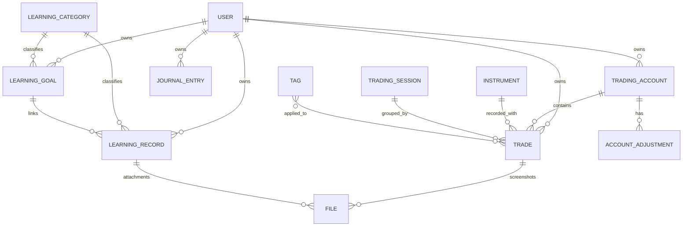

# Database Schema

> **Status: Phase 1 security collections are implemented.** The Trading, Learning, Journal, and operational collections below are approved for later phases and are not yet implemented.

Database: `ys_journal`  
MongoDB: `9.0.4`, standalone, `127.0.0.1:27017`  
ODM: Mongoose 9

## Common conventions

- Every owned document includes `userId`.
- Timestamps are stored in UTC as `Date` values.
- Trading, learning, and journal dates are stored as `YYYY-MM-DD` strings in the configured app time zone.
- Soft delete uses `deletedAt`, `deletedBy`, and optionally `deleteReason`.
- Mutable records use an integer `version` for optimistic concurrency.
- Audit logs are append-only.
- Monetary values are integer micro-USD (`$1.00 = 1_000_000`).
- Prices are integer ticks; quantities are integer hundredths.
- Personal Journal content is isolated and redacted from audit diffs.

## Implemented in Phase 1

| Collection        | Notes                                                                                                               |
| ----------------- | ------------------------------------------------------------------------------------------------------------------- |
| `users`           | Owner email, Argon2id hash (excluded from queries by default), `passwordVersion`, failed-login counters, last login |
| `sessions`        | Hashed token, sliding 7-day expiry with TTL index, owner reference, IP/user agent, revocation timestamp             |
| `security_events` | Append-only events with owner scope, IP, user agent, and sanitized metadata                                         |
| `settings`        | Owner-scoped appearance, time zone, study target, storage limit, and reminder preferences                           |
| `app_meta`        | Singleton instance ID, schema version, and one-time owner setup state                                               |

The setup source of truth is the existence of an owner user; `app_meta` records instance metadata and setup completion.

## Collections

### Identity and security

| Collection        | Important fields                                                                                                                    |
| ----------------- | ----------------------------------------------------------------------------------------------------------------------------------- |
| `users`           | `email`, `passwordHash`, `passwordVersion`, `displayName`, `role`, `createdAt`, `updatedAt`                                         |
| `sessions`        | `userId`, `tokenHash`, `lastActivityAt`, `expiresAt`, `ip`, `userAgent`, `revokedAt`                                                |
| `security_events` | `userId?`, `type`, `ip`, `userAgent`, `metadata`, `createdAt`                                                                       |
| `settings`        | `userId`, theme, font scale, reduced motion, app time zone, trading time zone, daily study target, reminder settings, storage limit |
| `app_meta`        | `instanceId`, `schemaVersion`, owner setup state, onboarding state                                                                  |

### Trading

| Collection            | Important fields                                                                                                                                                                                                                                                                                                                                        |
| --------------------- | ------------------------------------------------------------------------------------------------------------------------------------------------------------------------------------------------------------------------------------------------------------------------------------------------------------------------------------------------------- |
| `instruments`         | `symbol`, `name`, `pointValueMicros`, `tickValueMicros`, `tickSizeMicros`, `active`, `builtIn`                                                                                                                                                                                                                                                          |
| `trading_accounts`    | `name`, `broker`, `accountType`, `startingBalanceMicros`, `status`, `isDefault`, `archivedAt`, `version`                                                                                                                                                                                                                                                |
| `account_adjustments` | `accountId`, `type` (`deposit`, `withdrawal`, `correction`), `amountMicros`, `date`, `note`, `audit`                                                                                                                                                                                                                                                    |
| `tags`                | `type` (`setup`, `market_condition`, `custom`), `name`, `slug`, `color`, `builtIn`, `archivedAt`                                                                                                                                                                                                                                                        |
| `trading_sessions`    | `name`, `color`, display order, archive state                                                                                                                                                                                                                                                                                                           |
| `trades`              | `accountId`, account snapshot, `instrumentId`, instrument snapshot, `direction`, `entryPriceTicks`, `quantityHundredths`, `tradeDate`, session snapshot, `initialStopPriceTicks`, partial exits, `feesMicros`, risk fields, tag IDs/snapshots, checklist snapshot, emotions, rule violations, notes, lessons, calculated fields, `version`, `deletedAt` |
| `files`               | `ownerType`, `ownerId`, `originalName`, generated `storageKey`, `mimeType`, `sizeBytes`, `sha256`, image dimensions, label, soft delete                                                                                                                                                                                                                 |

#### Trade calculation fields

- `grossPnlMicros`
- `netPnlMicros` — `null` when fees are not entered
- `grossR` — `null` when selected risk is unavailable
- `outcomeGross` — `win`, `loss`, or `break_even`
- `outcomeNet` — `win`, `loss`, `break_even`, or `null`
- `formulaVersion`
- `calculatedAt`

Trades store immutable snapshots of instrument specs, account details, session name, and tag names. Editing configuration later must not rewrite historical calculations.

### Learning

| Collection            | Important fields                                                                                                                                                 |
| --------------------- | ---------------------------------------------------------------------------------------------------------------------------------------------------------------- |
| `learning_categories` | `name`, `slug`, `color`, `archivedAt`                                                                                                                            |
| `learning_records`    | `date`, `categoryId`, category snapshot, `topic`, key takeaways, `durationMinutes`, notes, resource links, attachment file IDs, `goalId`, `version`, `deletedAt` |
| `learning_goals`      | `title`, `description`, `categoryId`, `targetDate`, `status`, `progressPercent`, milestones, tasks, completion timestamps, `version`, `deletedAt`                |

### Personal Journal

| Collection        | Important fields                                                                                                                       |
| ----------------- | -------------------------------------------------------------------------------------------------------------------------------------- |
| `journal_entries` | `date`, highlights, challenges, lessons, gratitude[3], mood 1–5, reflection, free writing, tomorrow priorities, `version`, `deletedAt` |
| `quick_notes`     | `date`, text, `version`, `deletedAt`                                                                                                   |

One main journal entry per owner per date. Quick notes are additional records.

### Dashboard, posters, and operations

| Collection            | Important fields                                                                     |
| --------------------- | ------------------------------------------------------------------------------------ |
| `dashboard_layouts`   | `name`, `isDefault`, widgets with position/size/visibility/settings, `version`       |
| `poster_configs`      | poster type, dimension, template, colors, text overrides, logo placement, `version`  |
| `audit_logs`          | actor, action, entity type/ID, sanitized before/after values, request ID, timestamp  |
| `sync_operations`     | `userId`, `idempotencyKey`, request hash, stored response, timestamp                 |
| `backups`             | Drive file ID, version, checksum, size, modules, attachment flag, verification state |
| `backup_runs`         | scheduled time, start/end, status, missed flag, error                                |
| `oauth_accounts`      | provider, account email, encrypted refresh token, scopes, connection state           |
| `encryption_metadata` | KDF parameters, salt, wrapped Backup Data Key, recovery wrapper, auto-unlock wrapper |

## Relationships

## Indexes

Initial index plan:

- `users.email` unique.
- `sessions.tokenHash` unique; TTL on `expiresAt`.
- `trades` compound indexes for owner/date, owner/account/date, owner/instrument, owner/session, owner/tags, owner/outcome, owner/deletedAt.
- `account_adjustments` owner/account/date.
- `learning_records` owner/date and owner/category/date.
- `learning_goals` owner/status.
- `journal_entries` partial unique index on owner/date where `deletedAt` is null.
- Journal text index for private searchable fields.
- `files` owner/entity.
- `audit_logs` owner/createdAt.
- `sync_operations` unique owner/idempotency key; TTL for old idempotency records.
- `backups` owner/createdAt.
- Default account partial unique index where `isDefault` is true and not archived.

## Transactions

Standalone MongoDB does not support multi-document transactions. Multi-document operations must be idempotent and recoverable. Restores use staging, full validation, a safety backup, and explicit confirmation.

## Data isolation

Queries must always scope by owner ID, even while the first release has one owner. Authorization is enforced server-side. Personal Journal models are never imported by analytics, dashboard, poster, trading, or learning services.
