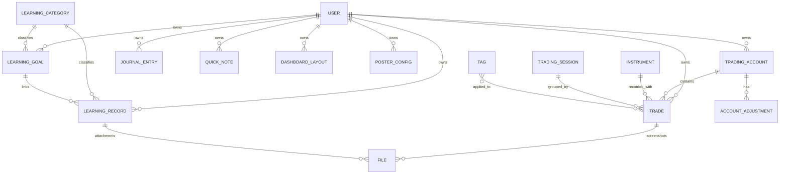

# Database Schema

> **Status: Phases 1–9 are implemented.** Identity/security, reference data, completed trades, private file metadata, trading analytics, account adjustments, learning categories/records/goals, the Personal Daily Journal (entries, quick notes, and reminder settings), dashboard layouts, poster configurations, and offline replay idempotency records are active. Calendar data and poster data are derived on request; no calendar or poster-data collection is stored. Other operational collections are planned for later phases.

Database: `ys_journal`  
MongoDB: `9.0.4`, standalone, `127.0.0.1:27017`  
ODM: Mongoose 9

## Common conventions

- Every owned document includes `userId`.
- Timestamps are stored in UTC as `Date` values.
- Trading, learning, and journal dates are stored as `YYYY-MM-DD` strings in the configured app time zone.
- Soft delete uses `deletedAt`, `deletedBy`, and optionally `deleteReason`.
- Mutable records use an integer `version` for optimistic concurrency.
- Audit logs are append-only.
- Monetary values are integer micro-USD (`$1.00 = 1_000_000`).
- Prices are integer ticks; quantities are integer hundredths.
- Personal Journal content is isolated and redacted from audit diffs.

## Implemented in Phase 1

| Collection        | Notes                                                                                                               |
| ----------------- | ------------------------------------------------------------------------------------------------------------------- |
| `users`           | Owner email, Argon2id hash (excluded from queries by default), `passwordVersion`, failed-login counters, last login |
| `sessions`        | Hashed token, sliding 7-day expiry with TTL index, owner reference, IP/user agent, revocation timestamp             |
| `security_events` | Append-only events with owner scope, IP, user agent, and sanitized metadata                                         |
| `settings`        | Owner-scoped appearance, time zone, study target, storage limit, and reminder preferences                           |
| `app_meta`        | Singleton instance ID, schema version, and one-time owner setup state                                               |

The setup source of truth is the existence of an owner user; `app_meta` records instance metadata and setup completion.

## Implemented in Phase 2

| Collection         | Notes                                                                                                                          |
| ------------------ | ------------------------------------------------------------------------------------------------------------------------------ |
| `instruments`      | Built-in NQ/MNQ/ES/MES specs, editable configuration, `active` archive flag, `builtIn` marker, owner scope                     |
| `trading_accounts` | One editable default `Main Account` with `$0.00` starting balance, live/demo type, archive state, partial unique default index |
| `tags`             | Setup, market-condition, and custom labels with slug, color, archive state                                                     |
| `trading_sessions` | Owner-defined trading sessions with slug, color, display order, archive state                                                  |
| `checklist_items`  | Owner-defined pre-trade checklist items with sort order and archive state                                                      |

All Phase 2 records use `version` for optimistic concurrency and require `expectedVersion` on updates.

## Implemented in Phase 3

| Collection | Notes                                                                                                                                                                                 |
| ---------- | ------------------------------------------------------------------------------------------------------------------------------------------------------------------------------------- |
| `trades`   | Completed trades with partial exits, authoritative calculations, immutable account/instrument/session/tag/checklist snapshots, review fields, soft delete, `version`, and owner scope |
| `files`    | Private screenshot metadata with generated `storageKey`, original name, MIME type, size, SHA-256, dimensions, owner type/ID, label, soft delete, and owner scope                      |

Screenshot bytes live under `storage/uploads/<userId>/<year>/<month>` by default. Clients receive generated file IDs only; no filesystem path or storage key is accepted from a client.

## Implemented in Phase 4

| Collection            | Notes                                                                                                                                  |
| --------------------- | -------------------------------------------------------------------------------------------------------------------------------------- |
| `account_adjustments` | Owner-scoped deposits, withdrawals, and signed corrections with `date`, `note`, soft delete, `version`, and owner/account/date indexes |

Analytics services query `trades` and `account_adjustments` only. They never import Personal Journal models. Missing-fee trades break net aggregates and account balance from that point forward rather than being treated as zero.

## Implemented in Phase 5

| Collection            | Notes                                                                                                                                                   |
| --------------------- | ------------------------------------------------------------------------------------------------------------------------------------------------------- |
| `learning_categories` | Owner-scoped study categories with unique slug, color, archive state, and `version`                                                                     |
| `learning_records`    | Dated study records with category snapshot, optional goal link, duration, notes, resource links, private attachments, soft delete, and `version`        |
| `learning_goals`      | Study goals with optional category snapshot, target date, status, embedded milestones and tasks, server-calculated progress, soft delete, and `version` |

Learning attachments reuse the private `files` collection through `ownerType: LearningRecord`. Deleting a learning record soft-deletes its active attachments with `deletedReason: learning_record_deleted`; restoring the record restores only attachments deleted by that action. Learning services never import Personal Journal models.

Milestones and tasks are embedded subdocuments. `progressPercent` is the rounded percentage of completed milestones plus completed tasks, recalculated on every nested change. It is derived state, not client input.

## Implemented in Phase 6

| Collection        | Notes                                                                                                      |
| ----------------- | ---------------------------------------------------------------------------------------------------------- |
| `journal_entries` | Owner-scoped daily entries with structured fields, mood, gratitude, priorities, soft delete, and `version` |
| `quick_notes`     | Owner-scoped dated notes with text, soft delete, and `version`                                             |

Reminder preferences are stored in `settings.reminders` (`journalEnabled`, `journalTime`). They contain no journal content and are evaluated locally on the Daily Journal page. Journal models are never imported by analytics, dashboard, poster, trading, or learning services.

## Implemented in Phase 7

| Collection          | Notes                                                                                                                                               |
| ------------------- | --------------------------------------------------------------------------------------------------------------------------------------------------- |
| `dashboard_layouts` | Owner-scoped layouts with a unique name, one default per owner, embedded widgets (id, visible, size, position, settings), `version`, and timestamps |

Dashboard layouts use `version` for optimistic concurrency and require `expectedVersion` on updates, default changes, and deletes. The settings document gained the boolean `calendarJournalIndicator` (default `false`); when enabled, calendar aggregation reads only the owner's active journal entry dates and returns a neutral `hasJournalEntry` boolean with no journal content. Dashboard widget data and calendar responses never include journal text, mood, gratitude, notes, priorities, or attachments.

## Collections

### Identity and security

| Collection        | Important fields                                                                                                                                                |
| ----------------- | --------------------------------------------------------------------------------------------------------------------------------------------------------------- |
| `users`           | `email`, `passwordHash`, `passwordVersion`, `displayName`, `role`, `createdAt`, `updatedAt`                                                                     |
| `sessions`        | `userId`, `tokenHash`, `lastActivityAt`, `expiresAt`, `ip`, `userAgent`, `revokedAt`                                                                            |
| `security_events` | `userId?`, `type`, `ip`, `userAgent`, `metadata`, `createdAt`                                                                                                   |
| `settings`        | `userId`, theme, font scale, reduced motion, app time zone, trading time zone, daily study target, reminder settings, calendar journal indicator, storage limit |
| `app_meta`        | `instanceId`, `schemaVersion`, owner setup state, onboarding state                                                                                              |

### Trading

| Collection            | Important fields                                                                                                                                                                                                                                                                                                                                                |
| --------------------- | --------------------------------------------------------------------------------------------------------------------------------------------------------------------------------------------------------------------------------------------------------------------------------------------------------------------------------------------------------------- |
| `instruments`         | `symbol`, `name`, `pointValueMicros`, `tickValueMicros`, `tickSizeMicros`, `active`, `builtIn`                                                                                                                                                                                                                                                                  |
| `trading_accounts`    | `name`, `broker`, `accountType`, `startingBalanceMicros`, `status`, `isDefault`, `archivedAt`, `version`                                                                                                                                                                                                                                                        |
| `account_adjustments` | `accountId`, `type` (`deposit`, `withdrawal`, `correction`), `amountMicros`, `date`, `note`, `audit`                                                                                                                                                                                                                                                            |
| `tags`                | `type` (`setup`, `market_condition`, `custom`), `name`, `slug`, `color`, `builtIn`, `archivedAt`                                                                                                                                                                                                                                                                |
| `trading_sessions`    | `name`, `color`, display order, archive state                                                                                                                                                                                                                                                                                                                   |
| `trades`              | `accountId`, account snapshot, `instrumentId`, instrument snapshot, `direction`, `entryPriceTicks`, `quantityHundredths`, `tradeDate`, session snapshot, `initialStopPriceTicks`, partial exits, `feesMicros`, risk fields, tag IDs/snapshots, checklist snapshot, emotions, rule violations, notes, lessons, review, calculated fields, `version`, `deletedAt` |
| `files`               | `ownerType` (`Trade` or `LearningRecord`), `ownerId`, `originalName`, generated `storageKey`, `mimeType`, `sizeBytes`, `sha256`, image dimensions, label, `deletedReason`, soft delete                                                                                                                                                                          |

#### Trade calculation fields

- `grossPnlMicros`
- `netPnlMicros` — `null` when fees are not entered
- `grossR` — decimal string for precision, `null` when selected risk is unavailable
- `weightedAverageExitTicks` / `weightedAverageExitPrice` — decimal strings
- `outcomeGross` — `win`, `loss`, or `break_even`
- `outcomeNet` — `win`, `loss`, `break_even`, or `null`
- `formulaVersion`
- `calculatedAt`

Trades store immutable snapshots of instrument specs, account details, session name, tag names, and checklist text. Editing configuration later must not rewrite historical calculations.

### Learning

| Collection            | Important fields                                                                                                                                                                                                            |
| --------------------- | --------------------------------------------------------------------------------------------------------------------------------------------------------------------------------------------------------------------------- |
| `learning_categories` | `name`, `slug`, `color`, `archivedAt`, `version`                                                                                                                                                                            |
| `learning_records`    | `date`, `categoryId`, category snapshot, `topic`, `keyTakeaways`, `durationMinutes`, `notes`, resource links, `goalId`, `version`, `deletedAt`, `deletedBy`                                                                 |
| `learning_goals`      | `title`, `description`, `categoryId`, category snapshot, `targetDate`, `status`, `progressPercent`, milestones (title, due date, completion), tasks (title, completion), `completedAt`, `version`, `deletedAt`, `deletedBy` |

Attachment file IDs are not embedded in learning records. Active attachments are resolved from `files` by `ownerType` and `ownerId`, matching the screenshot pattern.

Learning record fields:

- `date` — `YYYY-MM-DD` in the configured app time zone.
- `categorySnapshot` — immutable `id`, `name`, `slug`, and `color` captured when the record is created or its category changes.
- `goalId` — optional link to an owner-scoped learning goal; clearing it stores `null`.
- `durationMinutes` — integer 0–1440 used for daily totals and streaks.
- `resources` — up to 20 HTTP(S) links with optional labels.
- Streaks and daily summaries are computed from active records and the owner's daily study target; they are not stored.

### Personal Journal

| Collection        | Important fields                                                                                                                       |
| ----------------- | -------------------------------------------------------------------------------------------------------------------------------------- |
| `journal_entries` | `date`, highlights, challenges, lessons, gratitude[3], mood 1–5, reflection, free writing, tomorrow priorities, `version`, `deletedAt` |
| `quick_notes`     | `date`, text, `version`, `deletedAt`                                                                                                   |

One main journal entry per owner per date, enforced by a partial unique index where `deletedAt` is null. Quick notes are additional records. Both collections use owner-scoped queries, `deletedAt`/`deletedBy` soft deletion, and integer `version` for optimistic concurrency. Search reads only these two collections from the authenticated owner; no other domain service imports them.

### Dashboard

| Collection          | Important fields                                                                              |
| ------------------- | --------------------------------------------------------------------------------------------- |
| `dashboard_layouts` | `name`, `isDefault`, widgets with id/visibility/size/position/settings, `version`, timestamps |

Widget IDs are limited to `trades_summary`, `study_summary`, `calendar_activity`, and `goals_progress`. Sizes are `small`, `medium`, or `large`, positions are integers 0–50, and settings accept `basis` (`gross` or `net`) and `days` (7–365).

### Poster Studio

| Collection       | Important fields                                                                                                                                                                   |
| ---------------- | ---------------------------------------------------------------------------------------------------------------------------------------------------------------------------------- |
| `poster_configs` | `userId`, `name`, `type` (`trading`/`learning`/`trade`), `tradeId`, `template`, `dimension`, `accentColor`, text overrides, logo placement, `days`, `basis`, `version`, timestamps |

Poster names are unique per owner. Templates are `midnight`, `paper`, or `ember`; dimensions are `square` (1080×1080), `portrait` (1080×1350), or `story` (1080×1920). The period is 7–365 days. A `trade` config requires `tradeId` to reference one active, owner-scoped trade; other types store `null`. Poster data is assembled on request from trading analytics, learning summaries, or allowlisted completed-trade fields only; no poster-data collection is stored, and no private trade content fields are read.

### Offline operations

| Collection        | Important fields                                                                                     |
| ----------------- | ---------------------------------------------------------------------------------------------------- |
| `sync_operations` | `userId`, `key`, `method`, `path`, `status`, `statusCode`, stored `response`, `error`, `completedAt` |

`sync_operations` has a unique owner/key index and an owner/createdAt index. A completed response is replayed with `x-ysj-replayed: true`; a pending record returns `409 SYNC_IN_PROGRESS`.

### Planned operations

| Collection            | Important fields                                                                     |
| --------------------- | ------------------------------------------------------------------------------------ |
| `audit_logs`          | actor, action, entity type/ID, sanitized before/after values, request ID, timestamp  |
| `backups`             | Drive file ID, version, checksum, size, modules, attachment flag, verification state |
| `backup_runs`         | scheduled time, start/end, status, missed flag, error                                |
| `oauth_accounts`      | provider, account email, encrypted refresh token, scopes, connection state           |
| `encryption_metadata` | KDF parameters, salt, wrapped Backup Data Key, recovery wrapper, auto-unlock wrapper |

## Relationships

## Indexes

Initial index plan:

- `users.email` unique.
- `sessions.tokenHash` unique; TTL on `expiresAt`.
- `trades` compound indexes for owner/date, owner/account/date, owner/instrument, owner/session, owner/tags, owner/outcome, owner/deletedAt (implemented).
- `account_adjustments` owner/account/date.
- `learning_records` owner/date, owner/category/date, owner/goal/date, and owner/deletedAt/date.
- `learning_goals` owner/status/target date, owner/category/status, and owner/deletedAt/createdAt.
- `learning_categories` unique owner/slug and owner/archivedAt/name.
- `journal_entries` partial unique index on owner/date where `deletedAt` is null, plus owner/date and owner/deletedAt/date indexes (implemented).
- Journal search uses case-insensitive regular expressions scoped by owner over entry text fields and quick-note text (implemented).
- `dashboard_layouts` unique owner/name, partial unique owner/default where `isDefault` is true, and owner/updatedAt indexes (implemented).
- `poster_configs` unique owner/name and owner/updatedAt indexes (implemented).
- `files` owner/entity and owner/deletedAt/createdAt (implemented).
- `audit_logs` owner/createdAt.
- `sync_operations` unique owner/key and owner/createdAt (implemented); TTL for old idempotency records is planned.
- `backups` owner/createdAt.
- Default account partial unique index where `isDefault` is true and not archived.

## Transactions

Standalone MongoDB does not support multi-document transactions. Multi-document operations must be idempotent and recoverable. Restores use staging, full validation, a safety backup, and explicit confirmation.

## Data isolation

Queries must always scope by owner ID, even while the first release has one owner. Authorization is enforced server-side. Dashboard layouts and poster configs are owner-scoped; a foreign layout or poster ID returns `404`. Personal Journal models are never imported by analytics, dashboard, poster, trading, or learning services. Calendar aggregation reads journal entry dates only when the owner enables the journal marker, and it returns only a boolean. Automated tests inspect service imports and seed foreign-owned journal records to verify that owner scoping and module boundaries hold.
